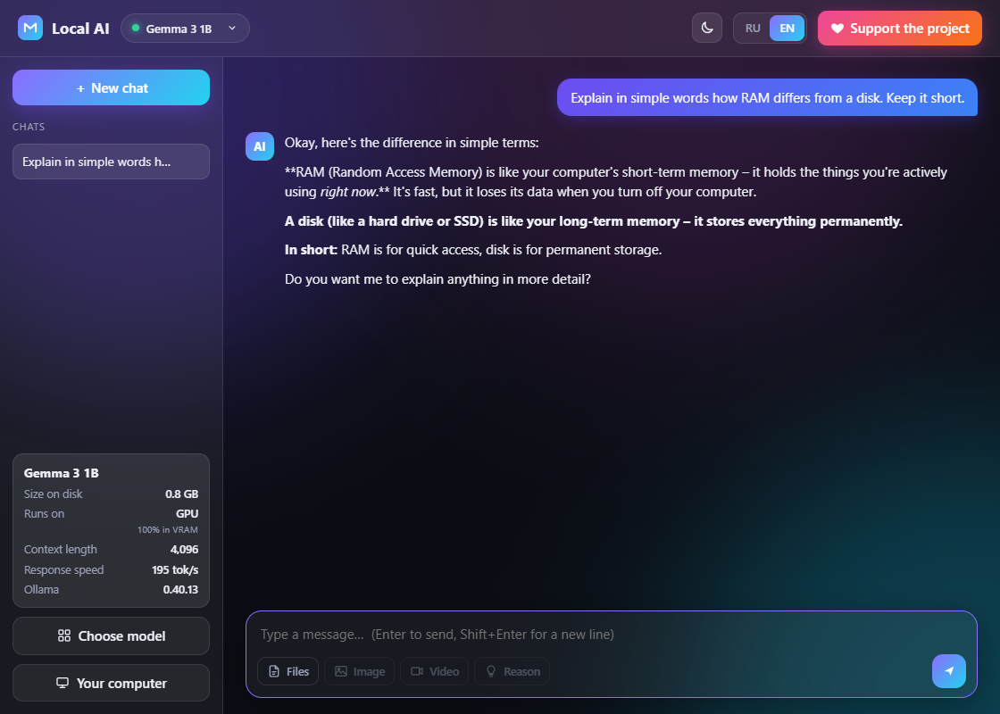
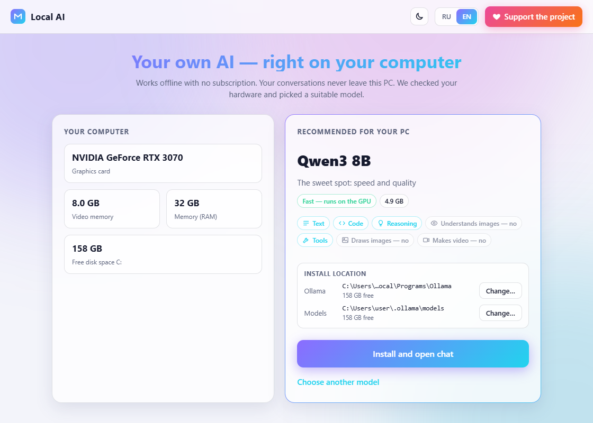
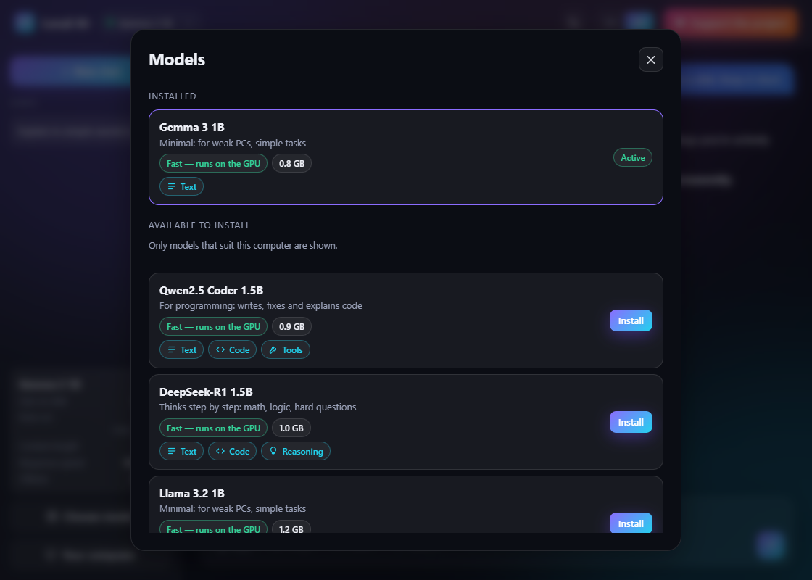
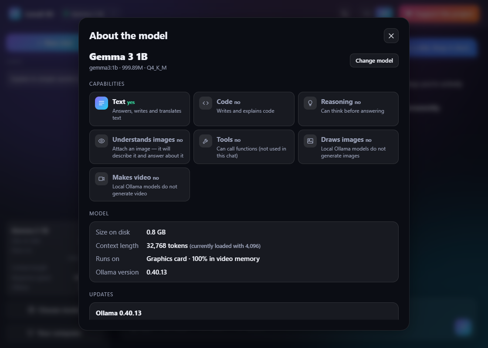
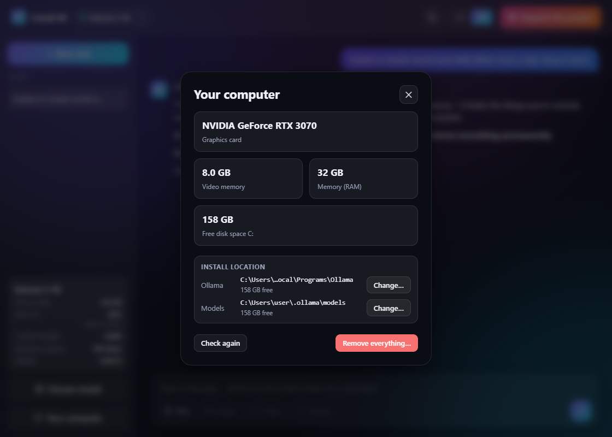

<p align="center">
  <a href="https://dalink.to/olegche"></a>
</p>

# Local AI

[Русский](README.md) · **English**

[](../../releases/latest)
[](../../releases)
[](#install)
[](https://ollama.com)
[](LICENSE)

Your own AI chat on your own PC in one click. The app checks your graphics card, memory and free disk space, **picks a model that fits**, installs [Ollama](https://ollama.com) and downloads the model. After that it is a plain chat: no internet, no subscription, no account, and your conversations never leave the computer.



**[⬇ Download the latest version (zip)](https://github.com/OlegChe77/local-ai/releases/latest/download/LocalAI.zip)** (`LocalAI.zip`, about 41 MB, a single `LocalAI.exe` inside)

Nothing to install, no Python needed. Works on Windows 10 and 11.

## Features

- **Picks a model for your hardware.** Detects the graphics card (NVIDIA, AMD), VRAM, RAM and free space. Recommends the strongest catalog model that fits entirely in VRAM; with no discrete GPU, a light model for the CPU. The picker lists only models that suit your PC.
- **A catalog of 34 models:** Qwen3, Gemma 3 and 3n, Llama 3.1 and 3.2, Mistral, Phi-4, DeepSeek-R1, Qwen2.5-Coder, Qwen2.5-VL, LLaVA, gpt-oss. Each shows its size, run mode (GPU, mixed, CPU) and capability badges: text, code, reasoning, images, tools. What a model cannot do is clear at a glance.
- **Sets everything up by itself.** Downloads the Ollama installer with resume, verifies its digital signature, installs silently (no administrator rights), downloads the model with a progress bar. You can choose the folders for Ollama and for models, and move models with one button.
- **Chat.** Streaming replies, Markdown and code blocks, several chats, a "Think" mode (shows the reasoning), attaching text files and images (for models that understand them), reply speed in tokens per second.
- **"About the model" panel:** capabilities, size, context length, where the model runs (GPU or CPU), Ollama version.
- **Updates:** checks for new versions of Ollama and of your models and updates them on request.
- **Clean uninstall:** "Remove everything…" deletes, at your choice, the models, Ollama and the app itself.
- Every model change (install, switch, delete) asks for your confirmation first.
- Interface in **Russian and English**, dark and light themes.

|  |  |
|:--|:--|
| Welcome: hardware and the recommended model | Catalog: only what suits your PC |

|  |  |
|:--|:--|
| About the model | "Your computer": hardware, folders, uninstall |

## Install

1. Download **[LocalAI.zip](https://github.com/OlegChe77/local-ai/releases/latest/download/LocalAI.zip)** (always the latest version) and unpack it.
2. Run `LocalAI.exe`. The app shows your hardware and the recommended model.
3. Click "Install and open chat" and confirm. Ollama (about 1.6 GB) and the model download by themselves; then the chat opens.

If Windows shows the blue SmartScreen window ("Windows protected your PC"): the app is not code-signed. Click "More info" → "Run anyway". Antivirus tools sometimes flag executables built with PyInstaller; the source is open, so you can build it yourself (see below).

Disk space: the Ollama installer and Ollama itself take about 3 GB, plus the model (1 to 20 GB). Downloading needs the internet; chatting does not.

## What goes where

- The chat talks to Ollama on the same computer (`127.0.0.1`); nothing is sent out.
- The network is used only to download Ollama from ollama.com, models from registry.ollama.ai, and to check for updates (GitHub and the Ollama registry).
- Settings live in `%APPDATA%\LocalAI`, chats in the app window's local storage; no accounts, no telemetry.

## Build from source

Needs Python 3.10+. Stack: Python, [pywebview](https://pywebview.flowrl.com/), a built-in HTTP server and plain HTML/CSS/JS in `ui/` (no bundlers or frameworks).

```
pip install -r requirements.txt
python app/main.py                       # run from source
powershell -ExecutionPolicy Bypass -File build.ps1   # dist\LocalAI.exe (PyInstaller, one file)
```

Debugging the UI in a browser without Ollama: `set LOCALAI_DEMO=1` and `python app/dev.py` (simulated install and chat; port from `LOCALAI_PORT`).

## Support the project

If the app is useful to you, you can support the author here: **https://dalink.to/olegche**. It is also the "Support the project" button inside the app.

## License

[MIT](LICENSE). Ollama and the models have their own licenses.
