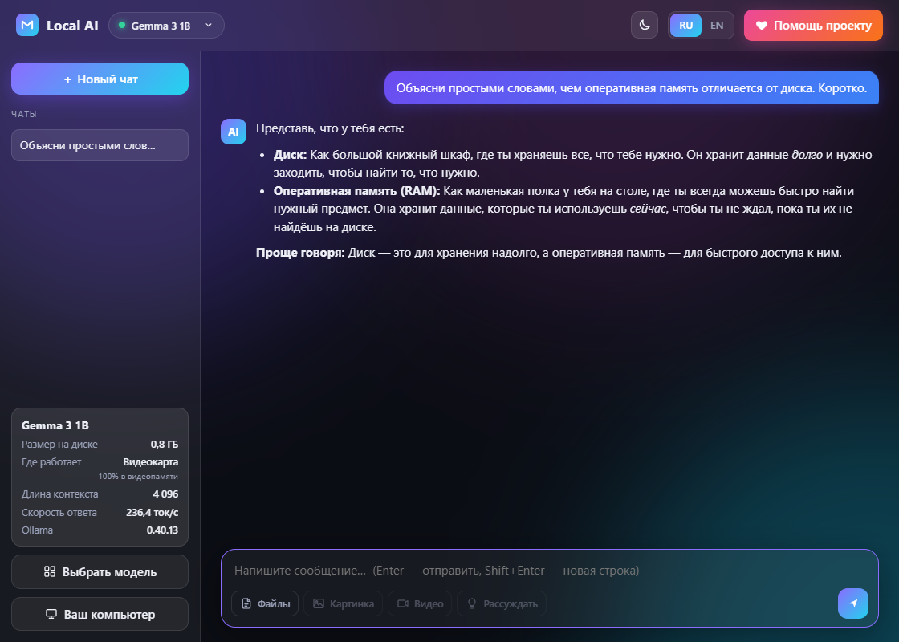
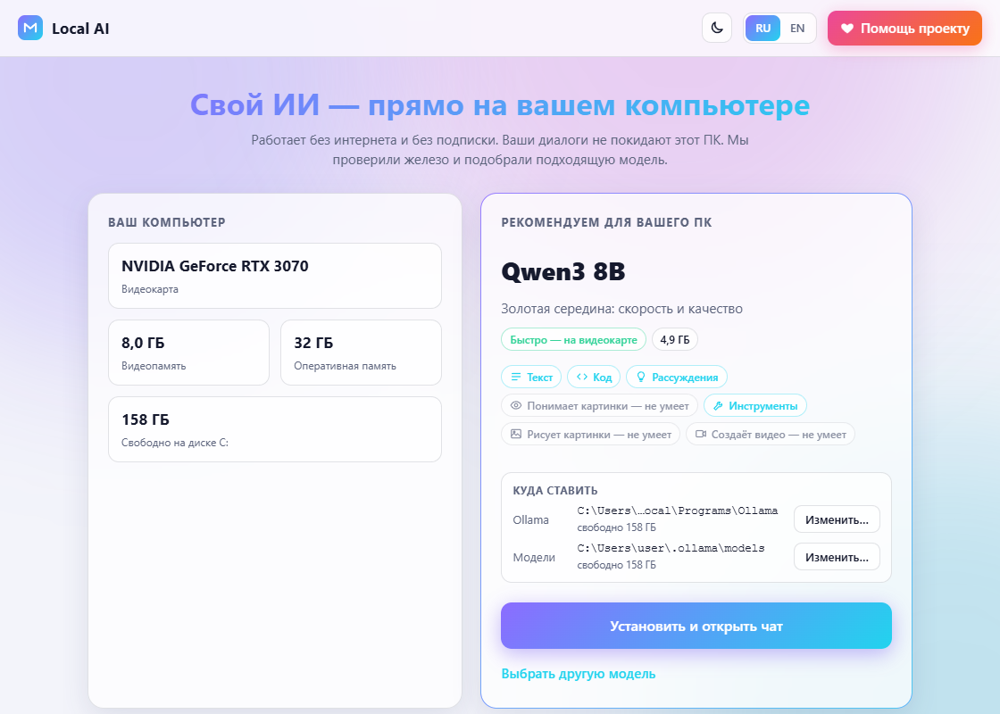
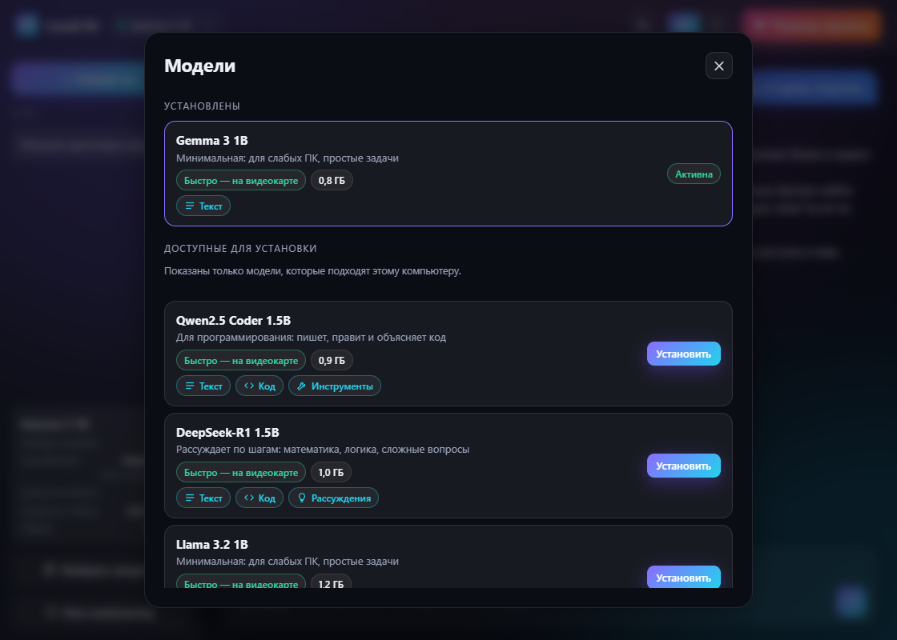
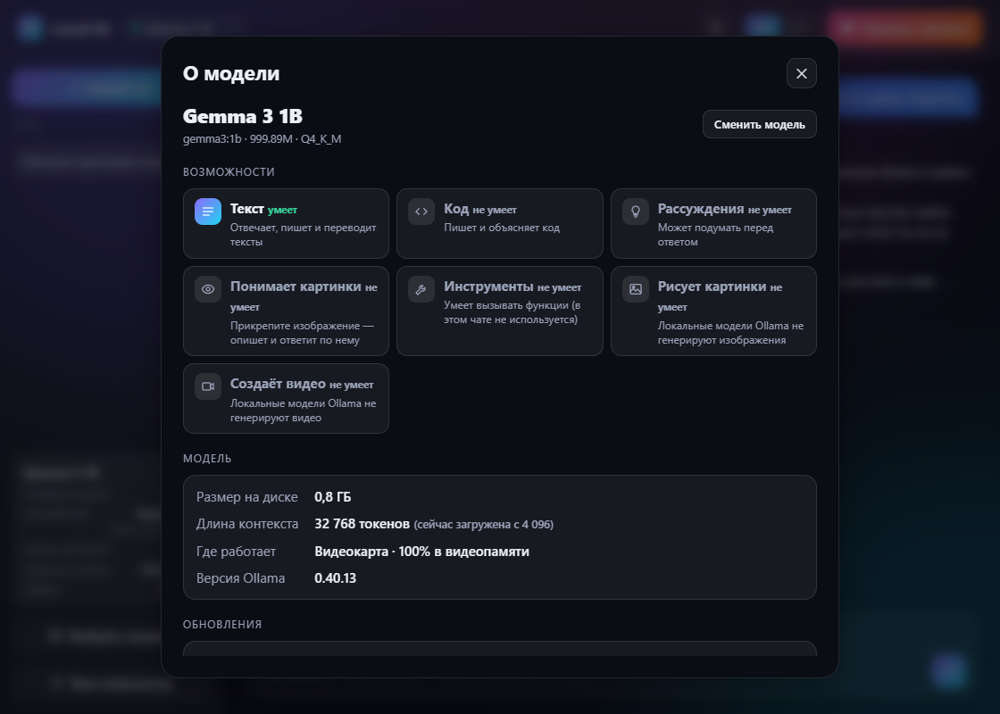
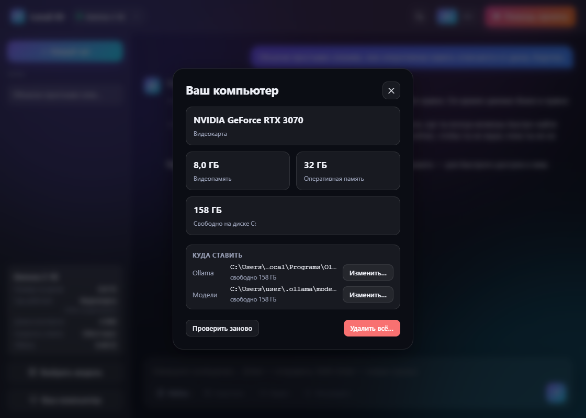

# Local AI

**Это форк [оригинального проекта Local AI](https://github.com/OlegChe77/local-ai).** В этом репозитории ведётся отдельная разработка и документация форка.

**Русский** · [English](README.en.md)

[](#установка)
[](https://ollama.com)
[](LICENSE)

Свой ИИ-чат на вашем компьютере в один клик. Программа определяет видеокарту, объём памяти и свободное место на диске, **подбирает подходящую модель**, помогает установить [Ollama](https://ollama.com) и скачать модель. После установки чат работает локально: без подписки и учётной записи.



Готовые сборки этого форка публикуются в [разделе Releases](https://github.com/FMulder007/FM-local-ai/releases), если для версии выпущен архив. Если готовой сборки пока нет, программу можно запустить или собрать из исходников — инструкции приведены ниже.

Ставить Python для готовой сборки не нужно. Программа рассчитана на Windows 10 и 11.

## Что умеет

- **Подбирает модель под железо.** Определяет видеокарту (NVIDIA, AMD), видеопамять, ОЗУ и свободное место. Рекомендует самую сильную модель из каталога, которая целиком влезает в видеопамять; без видеокарты — лёгкую модель для процессора. В окне выбора показаны только подходящие вашему ПК.
- **Каталог из 34 моделей:** Qwen3, Gemma 3 и 3n, Llama 3.1 и 3.2, Mistral, Phi-4, DeepSeek-R1, Qwen2.5-Coder, Qwen2.5-VL, LLaVA, gpt-oss. У каждой — размер, режим работы (видеокарта, смешанный, процессор) и значки возможностей: текст, код, рассуждения, картинки, инструменты. Чего модель не умеет, видно сразу.
- **Всё ставит само.** Скачивает установщик Ollama с возможностью продолжить прерванную загрузку, проверяет цифровую подпись, выполняет установку без прав администратора и скачивает модель с отображением прогресса. Папки для Ollama и моделей можно выбрать; модели можно перенести одной кнопкой.
- **Чат.** Потоковый ответ, Markdown и блоки кода, несколько чатов, режим «Рассуждать», прикрепление текстовых файлов и изображений (для моделей, которые их поддерживают), скорость ответа в токенах в секунду.
- **Панель «О модели»:** возможности, размер, длина контекста, где модель работает (видеокарта или процессор), версия Ollama.
- **Обновления:** программа проверяет версии Ollama и моделей; обновление выполняется по запросу пользователя.
- **Удаление:** команда «Удалить всё…» позволяет выбрать, какие модели, Ollama и файлы программы удалить.
- Любое изменение модели (установка, переключение, удаление) выполняется только после подтверждения.
- Интерфейс на **русском и английском**, тёмная и светлая темы.

|  |  |
|:--|:--|
| Приветствие: железо и рекомендованная модель | Каталог: только то, что подходит вашему ПК |

|  |  |
|:--|:--|
| Панель «О модели» | «Ваш компьютер»: железо, папки, удаление |

## Установка

1. Откройте [раздел Releases этого форка](https://github.com/FMulder007/FM-local-ai/releases) и скачайте архив, если для нужной версии опубликована готовая сборка. Если готового релиза пока нет, перейдите к разделу [«Сборка из исходников»](#сборка-из-исходников).
2. Распакуйте архив и запустите `LocalAI.exe`. Программа покажет сведения о вашем оборудовании и рекомендуемую модель.
3. Нажмите «Установить и открыть чат» и подтвердите действие. Ollama (около 1,6 ГБ) и выбранная модель будут загружены; после этого откроется чат.

Если Windows показывает окно SmartScreen («Windows защитила ваш компьютер»), учитывайте, что исполняемый файл может быть не подписан цифровой подписью. Перед запуском проверяйте происхождение сборки. Для проверки и самостоятельной сборки используйте исходный код этого репозитория.

Для установки нужны установщик Ollama и сама Ollama (около 3 ГБ), а также место для модели (примерно от 1 до 20 ГБ). Интернет требуется для загрузки компонентов и моделей; после их установки чат работает локально.

## Что и куда идёт

- Чат обрабатывается локальной Ollama на этом же компьютере (обычно `127.0.0.1:11434`).
- Сеть используется для загрузки Ollama с `ollama.com`, моделей с `registry.ollama.ai` и проверки обновлений через GitHub и реестр Ollama.
- Настройки программы хранятся в `%APPDATA%\\LocalAI`.
- История чатов хранится в локальном хранилище встроенного окна приложения (WebView), а не в отдельной серверной базе данных.
- Для работы с чатом не требуется учётная запись Local AI.

## Сборка из исходников

Нужен Python 3.10 или новее. Стек: Python, [pywebview](https://pywebview.flowrl.com/), встроенный HTTP-сервер и HTML/CSS/JavaScript в каталоге `ui/` (без сборщиков и JavaScript-фреймворков).

```powershell
pip install -r requirements.txt
python app/main.py
powershell -ExecutionPolicy Bypass -File build.ps1
```

Готовый исполняемый файл после сборки находится в `dist\\LocalAI.exe` (PyInstaller, один файл).

Для отладки интерфейса в браузере без Ollama установите переменную окружения `LOCALAI_DEMO=1` и запустите `python app/dev.py`. Этот режим имитирует установку и работу чата; порт задаётся переменной `LOCALAI_PORT`.

## Лицензия

[MIT](LICENSE). Ollama и используемые модели распространяются на условиях собственных лицензий.
